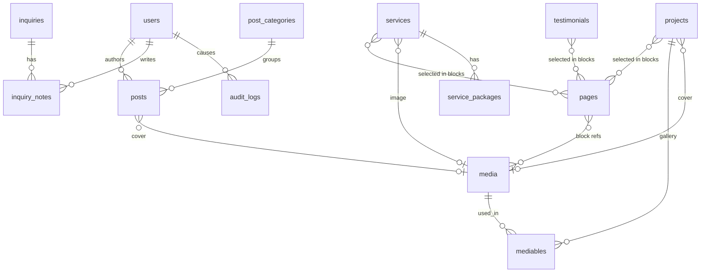

# Jebbari CMS architecture (proposal, for owner review)

Status: **approved and implemented (foundation).** See `CMS-IMPLEMENTATION.md` for what was built, the production requirements and the deviations. Owner decisions taken: draft overlay for every content type; Spatie Activitylog and Media Library; Dutch admin; one owner; MFA required; complete blog CMS.

Goal: manage almost all of jebbari.nl from `/admin` on an iPhone, iPad or computer, in Dutch and English, without touching code, while the design and animation system stay fully controlled by Blade components.

---

## 1. Verified compatibility

Checked with `composer require filament/filament --dry-run` against this project (composer.json and lock were not modified):

| Item | Result |
|---|---|
| Filament | **v5.11.2** (latest stable 5.x). Requires PHP ^8.2, `illuminate/contracts` ^11.28 \| ^12 \| ^13, `livewire/livewire` ^4.4.8, `ext-intl`. Resolves cleanly with Laravel 13.40 on PHP 8.4. |
| Weight | About 35 packages, admin-side only. Livewire loads only on `/admin` routes; public pages stay free of it (to be verified by test: no Livewire or Alpine-from-Filament assets on public pages, JS budget unchanged). |
| Official translatable plugin | `filament/spatie-laravel-translatable-plugin` is only published for the Filament 3 line (latest 3.3.57, needs `filament/support` 3). **Not usable with Filament 5**, so we build NL/EN editing ourselves (section 4). |
| `spatie/laravel-activitylog` 5.x, `spatie/laravel-medialibrary` | Compatible with Laravel 13 but require **PHP 8.4**. Alternatives below avoid tying hosting to 8.4. |
| This sandbox | PHP 8.4.27, `intl` present. **No GD and no Imagick installed**, so image variants (AVIF/WebP) cannot be tested until `php8.4-gd` is installed here (it is available via apt) or run on the real server. The VPS must provide GD with WebP and AVIF, or Imagick. |

## 2. Principles

1. **Content in the database, layout in code.** Editors fill typed fields. They never choose colours, sizes, spacing, animation or HTML structure.
2. **Typed blocks, not a page builder.** Each page has a fixed list of known block types with fixed fields. Editors can reorder, hide and (where allowed) repeat blocks. They cannot invent new layouts.
3. **Every translatable field has NL and EN, edited independently.**
4. **Live site is never half-edited.** Changes to published content stay unpublished until you press Publish (section 7).
5. **Honesty guards.** No made-up numbers: the spec-sheet values stay measured and read-only. Testimonials need a "permission confirmed" tick. Placeholders are visible in admin as "missing" until real content exists.
6. **Minimum dependencies.** Filament plus our own small traits (i18n, publishing, audit). Everything else is Laravel.

## 3. What is CMS-managed and what is not

| Managed in Filament | Stays in code (by design) |
|---|---|
| All page copy (homepage, services, work, about, contact intro), services, packages and prices, projects, testimonials, blog, legal pages | Layout, tokens, typography, components, animation system |
| Section visibility and order (within allowed blocks) | The set of block types and the system routes and their URL slugs (`/nl/werk`, `/en/work` stay stable for SEO) |
| Company details, contact email, booking link, social links, header status, footer text, navigation labels and order, SEO defaults | Interface microcopy: skip link, ARIA labels, form validation messages, "View case" label (stays in lang files; see decision 6) |
| Media and alt texts, SEO per item | `config/specs.php` measured values (shown read-only in admin with the date measured) |
| Inquiries, notes, status | Security headers and CSP |

## 4. Dutch and English content

- **Storage:** translatable fields are JSON columns `{ "nl": "...", "en": "..." }`. Slugs are the exception: two plain indexed columns `slug_nl`, `slug_en` (unique), so lookups are simple and portable across SQLite and MySQL/MariaDB.
- **Trait `Translatable`:** `$translatable = ['title', 'summary', ...]`. `$model->t('title')` returns the current locale, no silent cross-language fallback in templates. `$model->isTranslated('en')` checks required fields.
- **Admin editing:** a helper `TranslatedField::make('title', fn () => TextInput::make(...))` renders the same field once per language inside a language tab bar at the top of the form (**Nederlands | English**), sticky on mobile, with a badge showing how many fields are missing in each language. Fields keep their own validation per language.
- **Frontend policy for missing translations (decision 5):** recommended, an item without its EN required fields returns 404 in `/en/...`, is left out of the EN sitemap and `hreflang`, and the language switch sends the visitor to that locale's list page. No machine translation, no silent Dutch text on English pages.
- **Seeding:** the initial NL and EN copy comes only from the brief (hero line, supporting sentence, three services, four process steps, meeting line, positioning lines). Anything the brief does not provide is empty and flagged "missing".

## 5. Content model

### Tables

Common columns on publishable content (`pages`, `services`, `projects`, `testimonials`, `posts`): `status` (`draft` \| `published`), `published_at` (nullable; future date means scheduled), `draft_data` (JSON, nullable, section 7), `seo` (JSON, section 9), `created_at`, `updated_at`.

| Table | Key columns |
|---|---|
| `users` | name, email, password, `role` (`owner` \| `editor` \| `support`), MFA secret and recovery codes (Filament built-in app authentication, to confirm at implementation), `last_login_at` |
| `pages` | `key` unique (`home`, `about`, `services`, `work`, `contact`, `blog`, plus legal pages `privacy`, `terms`), `kind` (`system` \| `legal`), `title` (t), `blocks` JSON, `slug_nl`/`slug_en` (legal pages only; system slugs live in code) |
| `services` | `slug_nl/en`, `title` (t), `summary` (t, one sentence), `description` (t, rich), `included` (t list), `not_included` (t list), `timeline` (t), `tags` (string list), `image_id`, `sort` |
| `service_packages` | `service_id`, `name` (t), `scope` (t list), `price_from_cents` (nullable), `price_note` (t), `sort`, `is_visible`. Prices are only what you enter; empty shows "on request" |
| `projects` | `slug_nl/en`, `title` (t), `kind` (t, e.g. booking web app), `year`, `client_name`, `brief` (t), `built` (t, rich), `outcome` (t, one honest line), `stack` (string list), `url`, `is_featured`, `featured_sort`, `cover_media_id`, `sort` |
| `mediables` | `media_id`, `mediable_type/id`, `role` (`gallery` \| `cover` \| ...), `sort`, `alt` (t), `caption` (t). Used for project galleries, about images and others |
| `testimonials` | `name`, `company`, `role`, `quote` (t), `is_featured`, `permission_confirmed` (must be true to publish), `sort` |
| `post_categories` | `slug_nl/en`, `name` (t), `sort` |
| `posts` | `slug_nl/en`, `title` (t), `excerpt` (t), `body` (t, rich, limited toolbar), `category_id`, `author_id`, `cover_media_id`, `published_at`. Soft deletes |
| `media` | `disk`, `path`, `original_name`, `mime`, `size`, `width`, `height`, `alt` (t, default alt), `variants` JSON (generated widths and formats), `uploaded_by` |
| `inquiries` | `name`, `email`, `company`, `budget`, `message`, `locale`, `status` (`new` \| `in_progress` \| `completed` \| `spam`), `read_at` (null means unread), `completed_at`, `ip_hash`, `created_at`. Never deleted by a public action |
| `inquiry_notes` | `inquiry_id`, `user_id`, `body`, `created_at` (a note history, not one text box) |
| `settings` | `key` unique, `value` JSON. Groups: `company` (legal name, KvK, BTW, registered address), `contact` (email, booking URL), `social` (list of label and URL), `header` (taking-projects toggle, status text t), `footer` (text t), `seo` (site name, title template, default description t, default share image, handle), `analytics` (none \| cookieless URL) |
| `navigation_items` | `location` (`header` \| `footer`), `page_key` (nullable) or `url`, `label` (t), `sort`, `is_visible`. Legal links live here (footer) |
| `audit_logs` | `user_id` nullable, `event` (`created` `updated` `deleted` `published` `unpublished` `login` `login_failed` ...), `auditable_type/id`, `old` JSON, `new` JSON (field-level diff, passwords and secrets redacted), `ip`, `user_agent`, `created_at`. Append-only |
| existing | `sessions`, `cache`, `jobs`, `failed_jobs`, Filament `notifications` |

Why separate tables for services, projects, testimonials and posts but JSON blocks for pages: the first four are lists that other pages select from, filter and link to. Pages are a stack of known sections, which suits an ordered JSON array.

## 6. Page blocks (the "structured content" layer)

`pages.blocks` is an ordered array: `[{ "id": uuid, "type": "hero", "visible": true, "data": { ... } }]`.

Each block is one PHP class in `app/Content/Blocks/` that owns three things: its Filament form schema, its validation, and the Blade component that renders it (`resources/views/components/blocks/{type}.blade.php`). The renderer loops visible blocks, resolves the class from a registry, and ignores unknown types. Editors can never output raw HTML structure; rich text goes through a sanitiser and is styled only by our own typography CSS.

| Page | Allowed blocks (all translatable fields NL + EN) |
|---|---|
| Homepage | `hero` (mono label, headline lines, end-with-full-stop toggle, description, CTA label and link), `services_overview` (intro, all services or a chosen subset), `work_selection` (intro, featured or chosen projects, max 4), `process` (intro, 3 to 6 steps of title and description), `spec_sheet` (title and intro only; values from `config/specs.php`), `testimonials` (static quotes, no carousel; only if real ones exist), `closing_cta` (headline; email and booking link come from settings). Each at most once. Reorder and hide freely |
| Services page | `intro`, `service_list`, `packages_table` (from `service_packages`), `faq` (optional) |
| About | `intro` (personal introduction), `biography` (rich text), `image` (media, alt, caption), `skills` (list of name and text), `experience` (list of period, role, organisation, text), `principles` (3 to 4 one-liners), `meeting_line` |
| Work index | `intro` plus automatic project plates |
| Contact | `intro`, `meeting_line`, `reply_promise`; form fields and spam protection stay in code |
| Legal pages | single `rich_text` block (privacy statement, algemene voorwaarden), plus last-updated date |
| Blog | index intro only; articles are `posts` |

The headline line breaks are entered as one line per row, so `x-lines` can split them on the server and the full stop can land last. The hero's "end with the full stop" is a toggle, not styling.

## 7. Draft, publish and preview

- **New items** start as `draft`. A draft is invisible on the site.
- **Editing something already published does not change the live site.** The form saves into `draft_data` (only the changed fields). The record shows an **Unpublished changes** badge. Actions: **Preview**, **Publish changes**, **Discard changes**, **Unpublish**. One trait, `HasPublishing`, implements this for every publishable model.
- **Scheduling:** `published_at` in the future means the item appears automatically at that time (queries use `status = published AND published_at <= now()`), with no scheduler needed.
- **Preview:** opens in a new tab on a signed, expiring URL (30 minutes): `/preview/{type}/{id}`. It renders the real frontend with `draft_data` overlaid, a thin "Preview, not published" bar, `noindex`, and the visitor language chosen in the admin. It works on iPhone because it is just a link.
- **View live:** published items show a link to the live page in the same language.
- Cost note: the draft overlay is the largest piece of custom CMS logic (about one working day including tests). It is recommended for every publishable type so the behaviour is the same everywhere (decision 1).

## 8. Media

- **Upload:** Filament FileUpload to private storage, then a queued `GenerateMediaVariants` job. Allowed: JPEG, PNG, WebP, AVIF. **No SVG** (script risk). Max 10 MB, minimum and maximum dimensions validated. iPhone HEIC is converted by iOS when the picker is restricted to the allowed types.
- **Privacy:** EXIF (including GPS) is stripped on processing.
- **Variants:** widths 480, 768, 1200, 1600 and 2400 where the source allows, in AVIF, WebP and a JPEG/PNG fallback. Stored width and height feed explicit `width`/`height` attributes so there is no layout shift. The `x-picture` Blade component outputs `<picture>` with `srcset`, `sizes` and `loading="lazy"` (eager for above the fold).
- **Alt text:** per language, required before an image-bearing item can be published (a warning for decorative images that you mark as such).
- **Safety:** a media file referenced by any item cannot be deleted (admin shows "used in" with links).
- **Server requirement:** GD with WebP and AVIF, or Imagick, on the VPS (decision 3).

## 9. SEO

`seo` JSON on every publishable model and page: `title` (t), `description` (t), `og_image_id`, `noindex` (bool), `canonical_override` (rare). Resolution order: item SEO, then a template from settings (for example "{title} · Jebbari"), then site defaults. Admin shows a live character counter and a search-result preview. The sitemap lists only published items that are translated in that language, with `hreflang` pairs. JSON-LD (`ProfessionalService`) is generated from company and location settings, never from free text.

## 10. Filament panel

- **Path** `/admin`, login only (no registration), `noindex`, disallowed in `robots.txt`.
- **Navigation groups**
  - *Overview:* Dashboard (unread inquiries, drafts, unpublished changes, missing translations, recent audit events).
  - *Content:* Pages (Homepage, Services, About, Contact, Legal), Services, Projects, Testimonials, Blog (Posts, Categories), Media.
  - *Inbox:* Inquiries (with unread count badge).
  - *Site:* Company, Contact and booking, Social links, Header and footer, Navigation, SEO defaults, Analytics.
  - *System (owner only):* Users, Audit log.
- **Resources:** `PageResource`, `ServiceResource` (packages as a repeater), `ProjectResource` (gallery as an orderable repeater), `TestimonialResource`, `PostResource`, `PostCategoryResource`, `MediaResource`, `InquiryResource`, `UserResource`, `AuditLogResource` (read-only). Settings groups are custom Filament Pages over the `settings` table, one short form each.
- **Inquiries:** list shows unread in bold; opening a row marks it read; "Mark as completed", status filter, internal notes as a timeline, quick actions (reply by email, copy email). New inquiries also email you.

## 11. Mobile usability (a design requirement, not a bonus)

- Single-column forms, short sections, collapsed by default on small screens, sticky language tab bar and sticky Save and Publish actions.
- Tables use stacked card rows below the `md` breakpoint (title, status, language completeness) instead of wide columns.
- Large tap targets, no hover-only controls, no drag-only ordering: every sortable list also has Move up and Move down buttons.
- Uploads from the iPhone photo library and camera.
- Rich text uses a short toolbar (headings, bold, italic, link, lists, quote). Needs a real-device check on iOS Safari, as Tiptap editors can be finicky there.
- Verification: screenshots of every main screen at 390 and 820 px, plus a Playwright walk-through (create service, translate, preview, publish, upload an image, read an inquiry). **Limit:** this sandbox has Chromium only, so WebKit and a real iPhone still need your hands-on test.

## 12. Roles, permissions, security, audit

| Capability | owner | editor | support |
|---|---|---|---|
| Content (pages, services, projects, testimonials, blog) create, edit, publish | yes | yes | no |
| Delete content, restore versions | yes | no | no |
| Media upload | yes | yes | no |
| Inquiries read, notes, complete | yes | yes | yes |
| Settings (company, legal, navigation, SEO defaults) | yes | no | no |
| Users, audit log | yes | no | no |

- Implemented with an enum plus Laravel policies and Filament's authorisation hooks: **no permission-package dependency**.
- **Authentication:** authenticator-app MFA (recommended mandatory for the owner), login throttling, shorter session lifetime, password rules, no registration. `/admin` is a magnet for bots, so rate limits and MFA matter.
- **Audit:** an `Auditable` trait records created, updated, deleted, published and unpublished with old and new values, user and IP; login events come from auth listeners. The log is append-only in the UI. Retention 24 months with a prune command. An owner-only "restore this value" action reads from it.
- **Content safety:** rich text is sanitised on save and on render; links limited to http, https, mailto, tel; no script or iframe.
- **CSP:** public pages keep the strict policy (no `unsafe-eval`). Filament and Livewire need a different, looser policy on `/admin`, so CSP is applied per route group. Whether Livewire's CSP-safe mode removes the need for `unsafe-eval` is checked at implementation and reported.
- Backups: database and `storage/app` need backing up. The CMS makes the database the source of truth, so this becomes important (decision 3).

## 13. Frontend integration

- Controllers load a page by key, then `<x-blocks :page="$page" />` renders its visible blocks. List pages query published, translated, ordered records.
- Content is cached per locale under a version counter that increments on every publish, so public pages stay fast without cache tags (works on the file cache driver).
- `lang/` files shrink to interface microcopy only. Blade templates contain no website copy.
- `config/site.php` values (company, email, social, status) move into settings, with config as the fallback until they are filled.
- `x-plate`, `x-lines`, `x-section-label`, `x-spec-row` and the motion system are unchanged: blocks only pass them data.

## 14. Implementation plan (small commits, tests and screenshots each step)

1. **C1 Foundation**
   - Install Filament and create the `/admin` panel.
   - Users, roles, MFA, login throttling.
   - Traits `Translatable`, `HasPublishing`, `HasSeo`, `Auditable`.
   - Audit log and resource.
   - Mobile baseline: theme, navigation, dashboard shell.
2. **C2 Media and settings**
   - Media pipeline (variants, alt, EXIF strip, `x-picture`) and `MediaResource`.
   - Settings store with the Site pages.
   - Navigation items.
3. **C3 Content resources**
   - Services and packages, projects and gallery, testimonials.
   - Pages with the block system (homepage and about first).
   - Inquiries with status, read tracking and notes.
   - Blog (posts and categories) at the end, because it needs its own design approval (it is not in the original brief).
4. **C4 Preview and workflow polish:** signed previews, draft overlay everywhere, translation-gap dashboard, seeders from the brief's copy.
5. **Then page phases:** each frontend phase (Home, Work, Services, About, Contact, Blog) is built reading CMS data from day one, with its motion, screenshots and tests.

Tests throughout: policies per role, translation completeness and 404 policy, publish and schedule visibility, draft overlay and discard, preview URL expiry and `noindex`, media validation, audit entries, inquiry read and complete flow, sanitiser, and a check that public pages load no Filament or Livewire assets.

## 15. Risks and limits

- **Filament 5 is new**, so third-party plugins are thin (the translatable plugin proves it). Building our own i18n and audit keeps us independent but is our code to maintain.
- **Mobile admin testing is limited** here to Chromium emulation; a real iPhone check by you is required before sign-off.
- **Image variants can't be exercised** here until GD is installed (available via apt) and the production server must support AVIF and WebP.
- **Draft overlay** is custom logic with the most edge cases (slug changes, media removal, blocks). It is covered by tests but is the likeliest source of bugs.
- **Blog** adds routes and designs that the brief does not specify. It needs a design pass and your approval, so it is scheduled last.
- **Testimonials** must stay static and real: the brief bans carousels and invented quotes.

## 16. Decisions needed from you

1. **Draft overlay for already-published content** (section 7): recommended for all types (safe, about a day), or simple draft/published status only?
2. **Own traits for translatable, audit and media** (recommended, zero extra packages, no PHP 8.4 requirement) or Spatie packages `activitylog` and `medialibrary` (less custom code, PHP 8.4 required)?
3. **Hosting facts:** PHP version on the VPS, database (MySQL or MariaDB version), GD with AVIF/WebP or Imagick, whether a queue worker can run (a one-minute cron `queue:work --stop-when-empty` is Plesk-friendly), outgoing mail, and backup arrangements.
4. **Roles:** is `owner`, `editor`, `support` right, and will anyone besides you log in? Should MFA be mandatory for the owner? (Recommended: yes.)
5. **Missing EN (or NL) translation:** 404 that language and leave it out of hreflang and sitemap (recommended), or show the other language's text?
6. **Interface microcopy** (skip link, ARIA labels, validation messages, "View case"): keep in lang files (recommended) or make editable too?
7. **Blog:** confirm it is wanted now, and agree that its design is reviewed before it ships.
8. **Admin hardening:** keep the path exactly `/admin` as requested, with rate limiting and MFA, or use a less guessable path?
